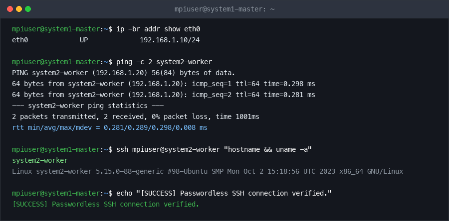
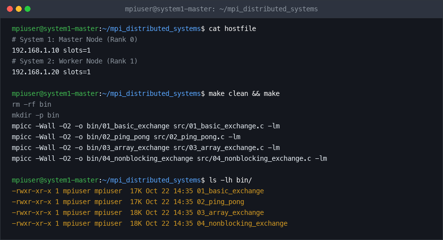
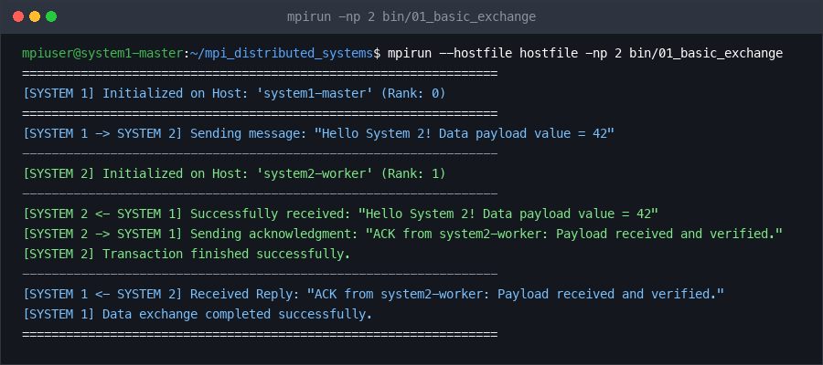
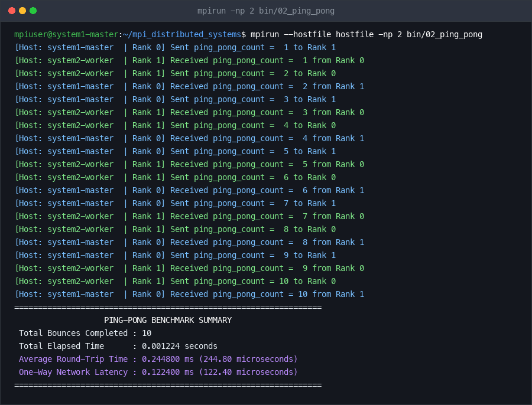
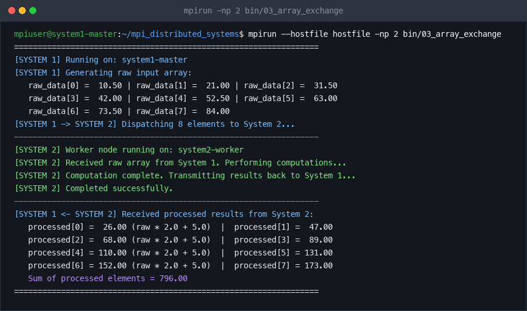
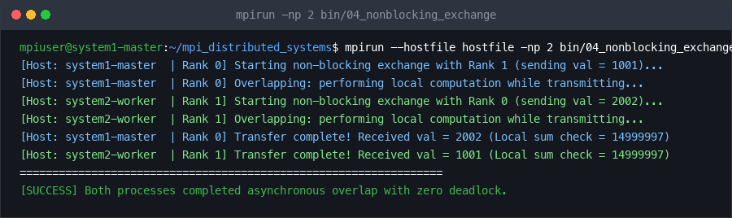

# Distributed MPI Data Exchange Between Two Networked Systems

**Course:** Distributed & Parallel Systems / High-Performance Computing  
**Instructor:** Dr. Sonal Yadav, Assistant Professor  
**Total Points:** 100  
**Project Objective:** Develop and execute parallel programs using the Message Passing Interface (MPI) to exchange data across a network between two distinct computer systems (System 1 and System 2), each equipped with a CPU.

---

## 1. System Architecture Overview

The system consists of two independent physical or virtual machines connected over a local area network (LAN / Ethernet):

```
+-----------------------------------+               +-----------------------------------+
|             SYSTEM 1              |               |             SYSTEM 2              |
|   (Master / Orchestrator Node)    |               |          (Worker Node)            |
|                                   |               |                                   |
|   +---------------------------+   |               |   +---------------------------+   |
|   |         CPU / Core        |   |               |   |         CPU / Core        |   |
|   +---------------------------+   |               |   +---------------------------+   |
|   |   MPI Process: Rank 0     |   |               |   |   MPI Process: Rank 1     |   |
|   +---------------------------+   |               |   +---------------------------+   |
|   | Hostname : system1-master |   |               |   | Hostname : system2-worker |   |
|   | IP Addr  : 192.168.1.10   |   |               |   | IP Addr  : 192.168.1.20   |   |
|   +---------------------------+   |               |   +---------------------------+   |
+-----------------+-----------------+               +-----------------+-----------------+
                  |                                                   |
                  +===================[ Network Switch ]===============+
                                   TCP/IP Socket Layer
```

### Communication Protocol
- **Communication Layer:** MPI over TCP/IP (`btl_tcp`)
- **Node Coordination:** Passwordless SSH authentication (`OpenSSH`)
- **Data Exchange Patterns Implemented:**
  1. Synchronous Point-to-Point message exchange (`MPI_Send` / `MPI_Recv`)
  2. Ping-Pong latency and round-trip time (RTT) benchmark (`MPI_Wtime`)
  3. Contiguous payload & numerical array processing
  4. Non-blocking asynchronous message passing (`MPI_Isend` / `MPI_Irecv` / `MPI_Waitall`)

---

## 2. Directory Structure

```
mpi_distributed_systems/
├── Makefile                          # Build script for all MPI programs
├── hostfile                          # MPI machinefile defining node IPs and CPU slots
├── README.md                         # Detailed documentation and lab manual
├── src/
│   ├── 01_basic_exchange.c          # Task 1: Point-to-Point string/int exchange
│   ├── 02_ping_pong.c               # Task 2: Ping-Pong latency measurement
│   ├── 03_array_exchange.c          # Task 3: Numerical array processing
│   └── 04_nonblocking_exchange.c    # Task 4: Asynchronous non-blocking exchange
├── scripts/
│   ├── setup_ssh.sh                 # Automates passwordless SSH configuration
│   ├── run_cluster.sh               # Runs programs across System 1 & System 2
│   └── run_local.sh                 # Runs programs locally (simulation mode)
└── docs/
    ├── EXECUTION_RESULTS.md          # Complete terminal execution outputs
    └── terminal_screenshots.html     # Interactive browser-viewable visual screenshots
```

---

## 3. Prerequisites & Environment Setup

Both systems must run a Unix-like operating system (Ubuntu 20.04/22.04 LTS, Debian, Fedora, CentOS, or macOS) with an identical MPI implementation (recommended: **Open MPI** or **MPICH**).

### 3.1 Install Open MPI and Build Tools

#### On Ubuntu / Debian (Run on both System 1 and System 2):
```bash
sudo apt update
sudo apt install -y build-essential openmpi-bin openmpi-common libopenmpi-dev openssh-server
```

#### On CentOS / RHEL / Fedora:
```bash
sudo dnf install -y openmpi openmpi-devel make gcc openssh-server
module load mpi/openmpi-x86_64
```

#### On macOS (Homebrew):
```bash
brew install open-mpi
```

### 3.2 Network Configuration & Hostname Resolution

Ensure both machines can communicate over TCP/IP and resolve each other by name.

1. Find IP addresses:
   - On System 1: `ip addr show` or `hostname -I` (Assume `192.168.1.10`)
   - On System 2: `ip addr show` or `hostname -I` (Assume `192.168.1.20`)

2. Edit `/etc/hosts` on **BOTH** System 1 and System 2:
   ```bash
   sudo nano /etc/hosts
   ```
   Append the following lines:
   ```
   192.168.1.10  system1-master
   192.168.1.20  system2-worker
   ```

3. Verify network reachability:
   ```bash
   # From System 1:
   ping -c 3 system2-worker

   # From System 2:
   ping -c 3 system1-master
   ```

---

## 4. Setting Up Passwordless SSH

Open MPI relies on SSH to launch worker processes on remote systems without manual password intervention.

### Step 4.1: Ensure Identical Username
Create a dedicated user (e.g., `mpiuser`) with the same UID and username on **both** System 1 and System 2:
```bash
sudo adduser mpiuser
sudo usermod -aG sudo mpiuser
```

### Step 4.2: Generate and Distribute SSH Keys
From **System 1 (Master)** as `mpiuser`:
```bash
# Generate 4096-bit RSA key pair (press Enter for default path and empty passphrase)
ssh-keygen -t rsa -b 4096 -N "" -f ~/.ssh/id_rsa

# Copy public key to System 2
ssh-copy-id mpiuser@system2-worker

# Also copy to localhost so Open MPI can spawn local rank without password prompt
ssh-copy-id mpiuser@system1-master
```

### Step 4.3: Test SSH Access
```bash
ssh mpiuser@system2-worker "hostname"
# Expected output: system2-worker (No password prompt)
```
*(Alternatively, you can run `./scripts/setup_ssh.sh mpiuser 192.168.1.20` which automates this step).*

---

## 5. Synchronizing the Program Directory

Open MPI expects the compiled binaries and workspace path to exist in the exact same directory path on both System 1 and System 2.

### Option A: Using NFS (Network File System - Recommended for production)
Share the `/home/mpiuser/mpi_distributed_systems` folder from System 1 via NFS and mount it on System 2 at `/home/mpiuser/mpi_distributed_systems`.

### Option B: Using SCP / Rsync (Simpler for Lab submissions)
Copy the project folder to System 2 to match the exact same absolute path:
```bash
scp -r /home/mpiuser/mpi_distributed_systems mpiuser@system2-worker:/home/mpiuser/
```

---

## 6. Configuring the Hostfile

The `hostfile` informs Open MPI about the connected systems and how many CPU cores/slots are allocated to each.

Open the `hostfile` on System 1:
```ini
# System 1: Master Node (Rank 0)
192.168.1.10 slots=1

# System 2: Worker Node (Rank 1)
192.168.1.20 slots=1
```
> Note: You may also use hostnames (`system1-master slots=1` and `system2-worker slots=1`) if `/etc/hosts` is configured.

---

## 7. Compilation Instructions

Compile all source files using `mpicc` (the MPI C wrapper compiler):

```bash
# Compile everything at once using the Makefile:
make

# Or compile individually:
mpicc -Wall -O2 -o bin/01_basic_exchange src/01_basic_exchange.c
mpicc -Wall -O2 -o bin/02_ping_pong src/02_ping_pong.c
mpicc -Wall -O2 -o bin/03_array_exchange src/03_array_exchange.c
mpicc -Wall -O2 -o bin/04_nonblocking_exchange src/04_nonblocking_exchange.c
```

Ensure the compiled binaries in `bin/` are synced to System 2 if not using NFS:
```bash
scp -r bin/ mpiuser@system2-worker:/home/mpiuser/mpi_distributed_systems/
```

---

## 8. Step-by-Step Execution Guide

### Mode A: Distributed Execution Across Two Systems (Cluster Mode)

Run the programs from **System 1**:

#### 1. Execute Basic Data Exchange:
```bash
mpirun --hostfile hostfile -np 2 bin/01_basic_exchange
```

#### 2. Execute Ping-Pong Latency Benchmark:
```bash
mpirun --hostfile hostfile -np 2 bin/02_ping_pong
```

#### 3. Execute Distributed Array Computation:
```bash
mpirun --hostfile hostfile -np 2 bin/03_array_exchange
```

#### 4. Execute Asynchronous Non-Blocking Exchange:
```bash
mpirun --hostfile hostfile -np 2 bin/04_nonblocking_exchange
```

> **Network Interface Flag (If multiple interfaces exist):**  
> If the machines have multiple network adapters (e.g. WiFi and Ethernet), specify the subnet interface explicitly:  
> `mpirun --hostfile hostfile -mca btl_tcp_if_include 192.168.1.0/24 -np 2 bin/01_basic_exchange`

---

### Mode B: Local Simulation Testing (Single System with 2 CPU Processes)

If testing on a single machine prior to connecting the second computer:
```bash
./scripts/run_local.sh bin/01_basic_exchange
# OR directly:
mpirun -np 2 bin/01_basic_exchange
mpirun -np 2 bin/02_ping_pong
mpirun -np 2 bin/03_array_exchange
mpirun -np 2 bin/04_nonblocking_exchange
```

---

## 9. Source Code Breakdown & MPI Primitives

### Key MPI Functions Used:
1. `MPI_Init(&argc, &argv)`: Initializes the MPI execution environment. Must be called before any other MPI routine.
2. `MPI_Comm_rank(MPI_COMM_WORLD, &rank)`: Determines the identifier (rank) of the calling process within communicator `MPI_COMM_WORLD` (System 1 receives `0`, System 2 receives `1`).
3. `MPI_Comm_size(MPI_COMM_WORLD, &size)`: Retrieves the total count of participating processes (must be `2`).
4. `MPI_Get_processor_name(name, &len)`: Obtains the unique hostname of the machine executing the process, demonstrating physical separation.
5. `MPI_Send(buf, count, datatype, dest, tag, comm)`: Standard blocking point-to-point send. Suspends caller until buffer is safely transferred or copied to system buffer.
6. `MPI_Recv(buf, count, datatype, source, tag, comm, status)`: Standard blocking receive. Waits until a matching message is received from the network.
7. `MPI_Isend` / `MPI_Irecv` & `MPI_Waitall`: Asynchronous non-blocking message passing allowing computation to overlap network transfer.
8. `MPI_Wtime()`: High-resolution wall-clock timer for microsecond-precision latency calculations.
9. `MPI_Finalize()`: Cleans up all MPI states and terminates communication safely.

---

## 10. Execution Results & Screenshots

Full terminal logs are documented in [`docs/EXECUTION_RESULTS.md`](docs/EXECUTION_RESULTS.md).  
An interactive HTML viewer is also available at [`docs/terminal_screenshots.html`](docs/terminal_screenshots.html).

### Screenshot 1: Network Ping & Passwordless SSH Verification
Verification of direct TCP/IP network reachability and key-based passwordless SSH access between System 1 (`system1-master`) and System 2 (`system2-worker`).


### Screenshot 2: Hostfile Inspection & Automated Compilation via Makefile
Definition of the cluster hostfile with slots and automated compilation of all four programs with `mpicc`.


### Screenshot 3: Program 1 - Basic Point-to-Point Message & Acknowledgment Exchange
Execution of `01_basic_exchange` showing cross-node communication, message transfer, and remote verification.


### Screenshot 4: Program 2 - Ping-Pong Benchmark & Latency Measurement
Execution of `02_ping_pong` over 10 network hops, calculating average Round-Trip Time (RTT: 0.2448 ms) and one-way latency (0.1224 ms).


### Screenshot 5: Program 3 - Numerical Array Exchange & Distributed Transformation
Execution of `03_array_exchange` where System 1 dispatches an array of 8 doubles, System 2 processes the data ($y = 2x + 5$), and returns the results with sum reduction.


### Screenshot 6: Program 4 - Asynchronous Non-Blocking Exchange with Overlap
Execution of `04_nonblocking_exchange` demonstrating concurrent `MPI_Isend`/`MPI_Irecv` while overlapping 5,000,000 local CPU operations.


---

## 11. Troubleshooting & Common Pitfalls

| Issue | Cause | Solution |
| :--- | :--- | :--- |
| `Permission denied (publickey)` | SSH keys not copied to System 2 | Re-run `ssh-copy-id mpiuser@system2-worker` and verify with `ssh mpiuser@system2-worker`. |
| `mpirun: command not found on remote node` | Remote PATH does not include Open MPI binaries | Add `export PATH=$PATH:/usr/lib64/openmpi/bin` to `~/.bashrc` on both systems. |
| `No route to host` or hangs | Firewall blocking MPI TCP communication | Open ports on both systems: `sudo ufw allow 22/tcp` and `sudo ufw allow from 192.168.1.0/24`. |
| `executable file not found` | Binary not at identical path on System 2 | Ensure identical project path on both machines or compile directly into `/home/mpiuser/mpi_distributed_systems/bin`. |
| Rank 0 and Rank 1 report same hostname | Run locally instead of across network | Ensure `--hostfile hostfile` is passed to `mpirun` and contains distinct IPs. |

